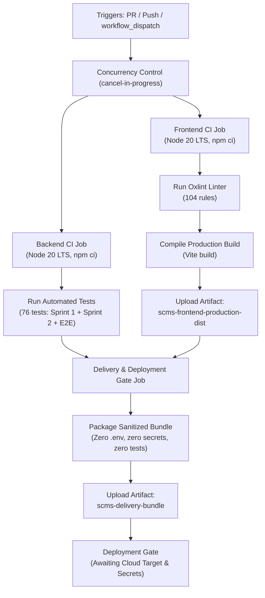

# Smart Complaint Management System (SCMS) — CI/CD Pipeline Documentation

## 1. Overview & Architecture

The SCMS Continuous Integration and Continuous Delivery (CI/CD) pipeline is implemented using **GitHub Actions** under [`.github/workflows/scms-ci-cd.yml`](file:///.github/workflows/scms-ci-cd.yml).

The pipeline guarantees that all contributions across **Sprint 1** and **Sprint 2** meet strict quality, security, and build standards prior to integration into `sprint1-user-complaint` and `main`.



---

## 2. Pipeline Triggers & Concurrency

### Triggers
- **Pull Requests**:
  - Targeting `main`
  - Targeting `sprint1-user-complaint`
- **Pushes**:
  - Branches: `main`, `sprint1-user-complaint`, `ci/**`, `feature/**`
- **Manual Execution**:
  - `workflow_dispatch` (available in GitHub Actions UI for on-demand verification)

### Concurrency
```yaml
concurrency:
  group: ${{ github.workflow }}-${{ github.ref }}
  cancel-in-progress: true
```
Prevents redundant pipeline runs on rapid subsequent pushes, saving CI runner minutes.

---

## 3. Jobs & Execution Stages

### 3.1 Backend CI (`backend-ci`)
* **Environment:** `ubuntu-latest`, Node.js 20 LTS.
* **Dependency Installation:** `npm ci` using `backend/package-lock.json` with npm caching enabled.
* **Test Runner:** Native Node.js test runner (`node --test`).
* **Test Suites Executed:**
  1. `test/dhruva_user_complaint.test.js` — Sprint 1 registration, authentication, logout, complaint lodging.
  2. `test/raksha_complaint_tracking.test.js` — Module 2 tracking, status display, cross-user isolation.
  3. `test/keertana_admin_management.test.js` — Module 3 admin login, complaint listing, details, health check.
  4. `test/shivaswaroop_resolution_closure.test.js` — Module 4 resolution flow, closure validation, audit logs.
  5. `test/integration_e2e.test.js` — Multi-role full end-to-end integration lifecycle (AT-01 to AT-05).
  6. `test/scms_13_user_complaints.test.js` — Sprint 2 user complaints view.
  7. `test/scms_14_track_status.test.js` — Sprint 2 status tracking timeline.
  8. `test/scms_sec_001_auth.test.js` — Security: protected endpoint authentication enforcement.
  9. `test/scms_sec_003_hashing.test.js` — Security: password hashing and credential suppression.
  10. `test/scms_nfr_003_usability.test.js` — Usability: field validations and confirmation IDs.
  11. `test/userAccount.test.js` — Model-level unit validations.
  12. `test/story_tests/*.test.js` — Story unit test suites (F-001 through F-007).
* **Test Isolation:** Powered by `mongodb-memory-server` in-memory MongoDB instances with mock JWT secrets. Requires no external database or network dependency.

### 3.2 Frontend CI (`frontend-ci`)
* **Environment:** `ubuntu-latest`, Node.js 20 LTS.
* **Dependency Installation:** `npm ci` using `frontend/package-lock.json` with npm caching enabled.
* **Linter:** `oxlint` checking React 19 components across 104 static rules.
* **Production Build:** `vite build` producing optimized client bundle in `frontend/dist/`.
* **Artifact Delivery:** Uploads `scms-frontend-production-dist` (retained for 7 days).

### 3.3 Continuous Delivery & Deployment Gate (`delivery-package`)
* **Needs:** `backend-ci` and `frontend-ci` must succeed.
* **Delivery Artifact:** Assembles a sanitized `delivery/` distribution directory combining:
  - Compiled static frontend in `delivery/public/`
  - Sanitized backend in `delivery/backend/`
  - Safe `.env.example` template
  - **Strictly excludes** `.env`, `.git`, `node_modules`, test files, and local logs.
* **Artifact Upload:** Uploads `scms-delivery-bundle` (retained for 7 days).
* **Deployment Gate:** Documents the required deployment environment configuration before live cloud deployment can be activated.

---

## 4. Production Deployment Prerequisites

The SCMS project currently implements **Continuous Delivery** (generating validated production artifacts). To enable **Continuous Deployment** (automatic cloud push), the following steps must be completed:

1. **Select Cloud Hosting Target**:
   - Backend API: Render / AWS ECS / Railway / DigitalOcean App Platform.
   - Frontend SPA: Vercel / Netlify / Cloudflare Pages / AWS S3 + CloudFront.
2. **Configure GitHub Repository Environment & Secrets**:
   - Environment Name: `Production`
   - Secret `MONGODB_URI`: Production MongoDB Atlas connection URI.
   - Secret `JWT_SECRET`: High-entropy production cryptographic key.
   - Secret `DEPLOY_API_KEY` / `WEBHOOK_URL`: Provider deployment webhook or token.
3. **Add Deployment Stage**:
   Attach an automated or approval-gated deployment step to the pipeline triggered specifically on git tags or approved merges to `main`.

---

## 5. Local Pipeline Reproduction

To run the exact checks executed by CI locally:

```bash
# 1. Run complete backend automated test suite
cd backend
npm ci
node --test test/*.test.js test/story_tests/*.test.js

# 2. Run frontend linter and production build
cd ../frontend
npm ci
npm run lint
npm run build
```
