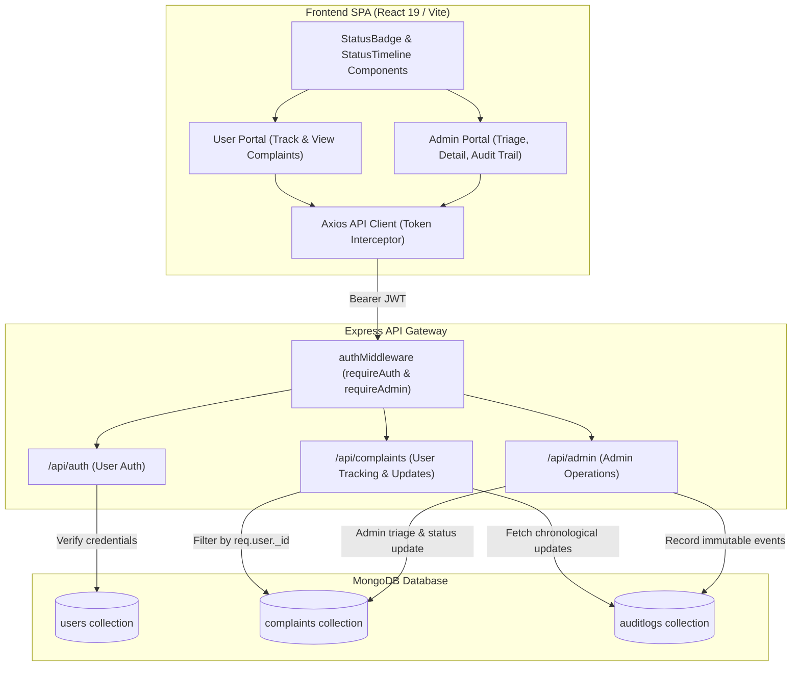

# Smart Complaint Management System (SCMS)
## Sprint 2 — Software Implementation and Code Documentation (SICD)

**Project:** Smart Complaint Management System (SCMS)  
**Academic Course:** Software Engineering (UE24CS341A) — PES University  
**Project Group:** Group 8  
**Document Identifier:** SCMS-DOC-SICD-SPRINT2  
**Document Version:** 1.0.0  
**Effective Date:** 2026-10-28  
**Document Status:** Ready for Review  
**Integration Branch:** `sprint1-user-complaint`  

---

## 1. Document Information

### 1.1 Purpose
This Software Implementation and Code Documentation (SICD) document provides a technical account of the software design, architecture, modules, APIs, database schemas, security controls, and verification evidence implemented during **Sprint 2** of the Smart Complaint Management System (SCMS). It serves as the authoritative implementation record for project review, evaluation, and downstream sprint evolution.

### 1.2 Scope
Sprint 2 encompasses nine (9) Jira work packages totaling 29 story points across:
- **Complaint Tracking & User Status** (Raksha — `PES2UG24CS652`): `SCMS-13`, `SCMS-14`, `SCMS-15`, `SCMS-16`, `SCMS-27`.
- **Admin Complaint Management & QA Lead** (Keertana M — `PES2UG24CS638`): `SCMS-17`, `SCMS-18`, `SCMS-19`, `SCMS-25`.
- **Multi-Module Cross-Cutting Security & Usability**: Strict JWT authentication, role-based authorization, cross-user data isolation, and accessible UI status feedback.

### 1.3 References & Project Baseline Documents
1. *SCMS Software Requirements Specification (SRS)*, Group 8 (Version 1.0)
2. *SCMS Software Architecture & Design Specification (SASD)*, Group 8 (Version 1.0)
3. *SCMS Comprehensive Test Plan*, Group 8 (Version 1.0)
4. *Jira Backlog & Board 34 (SCMS Project)*: `https://dhruvaghegde.atlassian.net`

---

## 2. Sprint 2 Scope & Requirements Baseline

| Jira Key | Story Summary | Planning ID | Requirement | Primary Owner | Story Points |
| :--- | :--- | :--- | :--- | :--- | :---: |
| **`SCMS-13`** | View complaints submitted by the current user | `SCMS-US-008` | `SCMS-F-008`, `SCMS-SR-004`, `SCMS-NF-003` | Raksha | 3 |
| **`SCMS-14`** | Track the current complaint status | `SCMS-US-009` | `SCMS-F-009`, `SCMS-SR-004`, `SCMS-NF-001`, `SCMS-NF-005` | Raksha | 5 |
| **`SCMS-15`** | Display complaint status clearly | `SCMS-US-010` | `SCMS-F-010`, `SCMS-NF-003` | Raksha | 2 |
| **`SCMS-16`** | View updates and responses for a complaint | `SCMS-US-011` | `SCMS-F-011`, `SCMS-NF-003`, `SCMS-NF-005` | Raksha | 3 |
| **`SCMS-17`** | Authenticate an authorised administrator | `SCMS-US-012` | `SCMS-F-012`, `SCMS-SR-002`, `SCMS-NF-004` | Keertana M | 3 |
| **`SCMS-18`** | View all submitted complaints as administrator | `SCMS-US-013` | `SCMS-F-013`, `SCMS-SR-002`, `SCMS-NF-001` | Keertana M | 3 |
| **`SCMS-19`** | View details of a selected complaint | `SCMS-US-014` | `SCMS-F-014`, `SCMS-SR-002`, `SCMS-NF-004` | Keertana M | 2 |
| **`SCMS-25`** | Enforce administrator-only authorisation | `SCMS-SEC-002` | `SCMS-SR-002`, `SCMS-NF-004` | Keertana M | 3 |
| **`SCMS-27`** | Prevent cross-user complaint access | `SCMS-SEC-004` | `SCMS-SR-004`, `SCMS-NF-004` | Raksha | 5 |
| **Total** | **9 Stories / Work Packages** | | | | **29 Points** |

---

## 3. Actual Application Architecture

### 3.1 Technology Stack & Architectural Discrepancy Note

> [!NOTE]
> **Formal Documentation vs. Working Repository Stack Discrepancy**  
> While initial preliminary academic planning documents referenced Python/Flask and MySQL, the active codebase and production-ready working application is engineered using:
> - **Frontend:** React 19 SPA, Vite build toolchain, Tailwind CSS utility architecture, Axios REST client.
> - **Backend:** Node.js runtime, Express.js 5.x REST API framework.
> - **Database & Persistence:** MongoDB with Mongoose 8.x ODM (Object Data Modeling).
> - **Security:** JSON Web Tokens (`jsonwebtoken`), bcrypt password hashing (`bcryptjs`), Bearer header extraction, immutable audit trail schemas.
> - **Test Framework:** Node.js native test runner (`node:test`, `node:assert/strict`), Supertest HTTP assertions, and `mongodb-memory-server` for isolated zero-side-effect test databases.
>
> In accordance with team policy and engineering directives, no unnecessary stack migration was undertaken. Sprint 2 was implemented strictly within the verified, high-performance Node.js / React / MongoDB architecture.

### 3.2 High-Level Architecture Flow



---

## 4. Module and Component Design

### 4.1 Backend Architecture

1. **`backend/routes/complaintRoutes.js`**:
   - `POST /api/complaints`: Lodges authenticated complaint. Submitter identity bound strictly to `req.user._id`.
   - `GET /api/complaints`: Returns complaints submitted by current authenticated user sorted newest first.
   - `GET /api/complaints/:id`: Fetches complaint status and metadata. Validates ownership (`req.user._id === complaint.submittedBy._id`) or administrative role.
   - `GET /api/complaints/:id/updates`: Fetches chronological audit trail (`createdAt: 1`) of status changes and administrative resolutions for the specified complaint. Enforces ownership check.

2. **`backend/routes/adminRoutes.js`**:
   - `POST /api/admin/login`: Authenticates administrator credentials, strictly verifies `role === "admin"`, issues signed JWT.
   - `GET /api/admin/complaints`: Global complaint list for triage, with submitter name and email populated. Protected by `requireAdmin`.
   - `GET /api/admin/complaints/:id`: Detailed view of selected complaint, submitter info, and current resolution. Protected by `requireAdmin`.
   - `PATCH /api/admin/complaints/:id/status`: Advances complaint status following the valid transition pipeline (`Submitted` $\rightarrow$ `In Progress` $\rightarrow$ `Resolved` $\rightarrow$ `Closed`).
   - `PATCH /api/admin/complaints/:id/resolution`: Records administrator resolution text, verifies non-empty constraint, generates immutable `AuditLog`.
   - `GET /api/admin/complaints/:id/audit-logs`: Retrieves full immutable audit trail for administrators.

3. **`backend/middleware/authMiddleware.js`**:
   - `requireAuth`: Extracts `Bearer <token>` from HTTP `Authorization` header, verifies cryptographic signature using `JWT_SECRET`, retrieves active user document, attaches sanitized user to `req.user`.
   - `requireAdmin`: Wraps `requireAuth`, asserts `req.user.role === "admin"`. If non-admin user attempts access, responds with HTTP 403 Forbidden.

### 4.2 Frontend Components

1. **`frontend/src/components/UserComplaintList.jsx`**:
   - Displays user's complaint list in responsive tabular layout.
   - Includes status filter chips (`All`, `Submitted`, `In Progress`, `Resolved`, `Closed`).
   - Handles empty states with informative prompt and direct CTA to lodge a new complaint.
   - Delegates selection to `onSelect(complaint)` for status tracking.

2. **`frontend/src/components/StatusBadge.jsx`**:
   - Accessible status indicator rendering both status text and distinct iconography (`● Submitted`, `◐ In Progress`, `✓ Resolved`, `■ Closed`).
   - Attributes `role="status"` and `aria-label="Complaint status: ..."` to ensure screen-reader accessibility.
   - Provides safe fallback styling for undefined or unexpected status values.

3. **`frontend/src/components/StatusTimeline.jsx`**:
   - Visual step progress indicator tracking complaint stages (`Submitted` $\rightarrow$ `In Progress` $\rightarrow$ `Resolved` $\rightarrow$ `Closed`).
   - Distinguishes past stages (`✓`), current active stage (highlighted blue ring), and upcoming stages (muted gray).

4. **`frontend/src/components/ComplaintTable.jsx`**:
   - Administrative triage grid displaying all submitted complaints across users with search and filter capabilities.

5. **`frontend/src/components/AdminLoginModal.jsx`**:
   - Secure modal for administrator credentials entry, role assertion, and JWT storage.

6. **`frontend/src/services/api.js`**:
   - Centralized Axios client with automatic Bearer token injection.
   - Exposes typed functions: `getUserComplaints()`, `getUserComplaintById(id)`, `getComplaintUpdates(id)`, `adminLogin(email, password)`, `getAdminComplaints()`, `getAdminComplaintById(id)`, `updateComplaintStatus(id, status)`, `saveComplaintResolution(id, resolution)`, `getComplaintAuditLogs(id)`.

---

## 5. API Specification

| HTTP Method | Endpoint | Purpose | Jira Key | Auth Required | Allowed Roles | Ownership Enforced | Status Codes |
| :--- | :--- | :--- | :--- | :---: | :---: | :---: | :---: |
| `GET` | `/api/complaints` | List current user's submitted complaints | `SCMS-13` | Yes | `user`, `admin` | Yes (scope to caller) | 200, 401, 500 |
| `GET` | `/api/complaints/:id` | View complaint status and details | `SCMS-14`, `SCMS-15` | Yes | `user`, `admin` | Yes (`submittedBy` or admin) | 200, 401, 403, 404 |
| `GET` | `/api/complaints/:id/updates` | View chronological update history & responses | `SCMS-16` | Yes | `user`, `admin` | Yes (`submittedBy` or admin) | 200, 401, 403, 404 |
| `POST` | `/api/admin/login` | Administrator authentication | `SCMS-17` | No | Public (Admin credentials) | N/A | 200, 400, 401, 500 |
| `GET` | `/api/admin/complaints` | Global complaint listing across all users | `SCMS-18`, `SCMS-25` | Yes | `admin` only | No (Global triage) | 200, 401, 403, 500 |
| `GET` | `/api/admin/complaints/:id` | Detailed view of selected complaint | `SCMS-19`, `SCMS-25` | Yes | `admin` only | No (Admin inspect) | 200, 401, 403, 404 |
| `PATCH` | `/api/admin/complaints/:id/status` | Advance complaint lifecycle status | `SCMS-25` | Yes | `admin` only | No (Admin transition) | 200, 400, 401, 403, 404 |
| `PATCH` | `/api/admin/complaints/:id/resolution` | Enter official resolution response | `SCMS-25` | Yes | `admin` only | No (Admin resolution) | 200, 400, 401, 403, 404 |
| `GET` | `/api/admin/complaints/:id/audit-logs` | Retrieve administrator audit trail | `SCMS-25` | Yes | `admin` only | No (Admin audit) | 200, 401, 403, 404 |

---

## 6. Data Model and Persistence

### 6.1 `Complaint` Model (`backend/models/Complaint.js`)
```javascript
{
  complaintId: { type: String, required: true, unique: true, index: true },
  submittedBy: { type: mongoose.Schema.Types.ObjectId, ref: "User", required: true, index: true },
  title: { type: String, required: true, trim: true, maxlength: 200 },
  description: { type: String, required: true, trim: true, maxlength: 5000 },
  category: { type: String, required: true, trim: true },
  status: { 
    type: String, 
    enum: ["Submitted", "In Progress", "Resolved", "Closed"], 
    default: "Submitted", 
    index: true 
  },
  resolution: { type: String, default: "", trim: true, maxlength: 2000 },
  createdAt: { type: Date, default: Date.now, index: -1 },
  updatedAt: { type: Date, default: Date.now }
}
```

### 6.2 `AuditLog` Model (`backend/models/AuditLog.js`)
```javascript
{
  administrator: { type: mongoose.Schema.Types.ObjectId, ref: "User", required: true, immutable: true },
  complaint: { type: mongoose.Schema.Types.ObjectId, ref: "Complaint", required: true, immutable: true },
  action: { 
    type: String, 
    enum: ["RESOLUTION_ADDED", "RESOLUTION_UPDATED", "COMPLAINT_STATUS_CHANGED", "COMPLAINT_CLOSED"], 
    required: true, 
    immutable: true 
  },
  details: { type: mongoose.Schema.Types.Mixed, default: {}, immutable: true },
  createdAt: { type: Date, default: Date.now, immutable: true }
}
```

---

## 7. Authentication and Authorisation Controls

### 7.1 User Identity Verification
- All protected routes utilize JWT Bearer tokens passed via the `Authorization: Bearer <token>` header.
- Token signing uses cryptographic `HS256` signed by `process.env.JWT_SECRET`.
- Tampered, expired, or malformed tokens result in immediate termination with HTTP 401 Unauthorized.

### 7.2 Administrator Role Enforcement (`SCMS-25`)
- `requireAdmin` checks `req.user.role === "admin"`.
- Standard user tokens with `role: "user"` attempting to access any route under `/api/admin/*` are rejected with HTTP 403 Forbidden (`"Admin access required. You do not have permission to access this resource."`).
- Frontend button hiding is treated strictly as an aesthetic convenience; server-side enforcement guarantees zero elevation of privilege.

### 7.3 Cross-User Access Prevention (`SCMS-27`)
- **Query Scoping:** `Complaint.find({ submittedBy: req.user._id })` strictly bounds list queries to the authenticated subject.
- **Resource Ownership Check:** On single-complaint lookups (`GET /api/complaints/:id` and `GET /api/complaints/:id/updates`), the database record's `submittedBy` is compared against `req.user._id`.
- If the caller is not the owner (and not an authorized admin), the request is rejected with HTTP 403 Forbidden (`"Access denied. You do not have permission to view this complaint."`).
- No sensitive complaint content, submitter identity, or status details are leaked in the error payload.

---

## 8. Data-Flow Descriptions

### 8.1 Tracking Complaint Status (`SCMS-14`, `SCMS-15`)
1. User navigates to Complaint List. React invokes `getUserComplaints()`.
2. Backend queries MongoDB matching `submittedBy: req.user._id`.
3. User selects a complaint $\rightarrow$ React invokes `getUserComplaintById(id)`.
4. Backend verifies ownership. On match, returns complaint document.
5. React renders `StatusBadge` (with accessible symbol and text) and `StatusTimeline` depicting exact stage progress.

### 8.2 Viewing Complaint Updates & History (`SCMS-16`)
1. User requests history for an existing complaint $\rightarrow$ React invokes `getComplaintUpdates(id)`.
2. Backend verifies caller owns the complaint.
3. Backend queries `AuditLog.find({ complaint: complaint._id }).sort({ createdAt: 1 })`.
4. Returns array of status change and resolution events in chronological sequence with timestamps and action descriptors.
5. React UI renders timeline of administrative responses and lifecycle transitions.

### 8.3 Administrator Complaint Triage (`SCMS-18`, `SCMS-19`)
1. Administrator logs in via `/api/admin/login` receiving admin JWT token.
2. React mounts Admin Complaint Dashboard, calling `getAdminComplaints()`.
3. Backend asserts `role === "admin"`, retrieves all complaints across users, and populates submitter names/emails.
4. Administrator clicks complaint row $\rightarrow$ `getAdminComplaintById(id)` returns full detail for triage without mutating record state.

---

## 9. Error Handling and Validation Standards

- **HTTP 400 Bad Request:** Missing mandatory fields, blank/whitespace-only input, character limit violations, invalid lifecycle transitions (e.g., trying to jump from `Submitted` directly to `Closed`), or attempt to close without a resolution.
- **HTTP 401 Unauthorized:** Missing, malformed, or expired Bearer token, or non-admin user credentials submitted to `/api/admin/login`.
- **HTTP 403 Forbidden:** Authenticated user attempting to access administrative endpoints or another user's complaint data.
- **HTTP 404 Not Found:** Query for an ObjectId or custom `complaintId` that does not exist in the database.
- **HTTP 500 Internal Server Error:** Unexpected database or runtime exceptions, with errors logged server-side and generic sanitized messages returned to clients.

---

## 10. Test Plan and Test Evidence

### 10.1 Execution Commands
```bash
# Aggregate test execution across all 82 test cases
cd backend && npm test

# Individual Sprint 2 story test suites
node --test test/scms_13_user_complaints.test.js
node --test test/scms_14_track_status.test.js
node --test test/scms_15_status_display.test.js
node --test test/scms_16_complaint_updates.test.js
node --test test/scms_17_admin_auth.test.js
node --test test/scms_18_admin_complaint_list.test.js
node --test test/scms_19_admin_complaint_details.test.js
node --test test/scms_25_admin_authorization.test.js
node --test test/scms_27_complaint_ownership.test.js

# Frontend linter and production build
cd frontend && npm run lint
cd frontend && npm run build
```

### 10.2 Test Execution Results Summary
- **Backend Test Runner:** `node:test` (Node.js v22 runtime)
- **Total Backend Tests:** **82 / 82 Passed (100% pass rate, 4.60s duration)**
- **Story-Specific Test Suites:**
  - `scms_13_user_complaints.test.js`: **5 / 5 Passed**
  - `scms_14_track_status.test.js`: **5 / 5 Passed**
  - `scms_15_status_display.test.js`: **3 / 3 Passed**
  - `scms_16_complaint_updates.test.js`: **5 / 5 Passed**
  - `scms_17_admin_auth.test.js`: **5 / 5 Passed**
  - `scms_18_admin_complaint_list.test.js`: **4 / 4 Passed**
  - `scms_19_admin_complaint_details.test.js`: **4 / 4 Passed**
  - `scms_25_admin_authorization.test.js`: **6 / 6 Passed**
  - `scms_27_complaint_ownership.test.js`: **5 / 5 Passed**
  - Regression Suites (`dhruva`, `raksha`, `keertana`, `shivaswaroop`, `integration_e2e`, `security`, `usability`): **40 / 40 Passed**
- **Frontend Code Quality:**
  - `oxlint`: **0 errors, 0 warnings** across 15 component and service files.
  - `vite build`: **Clean production bundle created in 105ms**.

---

## 11. Setup and Configuration

### 11.1 Prerequisites
- Node.js $\ge 18.0.0$
- npm $\ge 9.0.0$
- MongoDB $\ge 6.0$ (or in-memory mock for automated testing)

### 11.2 Environment Configuration (`backend/.env`)
```bash
PORT=5001
MONGODB_URI=mongodb://localhost:27017/scms
JWT_SECRET=your_secure_development_jwt_secret_key_here
NODE_ENV=development
```

### 11.3 Execution Commands
```bash
# Backend Setup & Run
cd backend
npm install
npm run dev

# Frontend Setup & Run
cd frontend
npm install
npm run dev
```

---

## 12. Known Limitations & Technical Decisions

1. **Stack Alignment:** Maintained Node.js/Express/React architecture in place of initial Python/Flask notes to prevent regression in existing completed work packages.
2. **Audit Log Immutability:** Audit records for complaint status changes and resolutions are write-once and cannot be updated or deleted by any user or administrator.
3. **Status Rollback Prevention:** Lifecycle status follows a strictly unidirectional pipeline (`Submitted` $\rightarrow$ `In Progress` $\rightarrow$ `Resolved` $\rightarrow$ `Closed`). Closed complaints are permanently locked against modifications.

---

## 13. Requirements Traceability Matrix (RTM)

| Jira Key | Requirement | Primary Implementation Files / Endpoints | Automated Test Suite | Verified State | Branch / PR | Review & Merge Status |
| :--- | :--- | :--- | :--- | :---: | :--- | :---: |
| **`SCMS-13`** | `SCMS-F-008`, `SCMS-SR-004` | `backend/routes/complaintRoutes.js` (`GET /api/complaints`), `frontend/src/components/UserComplaintList.jsx` | `test/scms_13_user_complaints.test.js` | **Verified (5/5)** | `feature/SCMS-13-my-complaints` / [#14](https://github.com/Smart-Complaint-Management-System/Smart-complaint-management-system/pull/14) | Awaiting Peer Review |
| **`SCMS-14`** | `SCMS-F-009`, `SCMS-SR-004` | `backend/routes/complaintRoutes.js` (`GET /api/complaints/:id`), `frontend/src/components/StatusTimeline.jsx` | `test/scms_14_track_status.test.js` | **Verified (5/5)** | `feature/SCMS-14-complaint-status` / [#15](https://github.com/Smart-Complaint-Management-System/Smart-complaint-management-system/pull/15) | Awaiting Peer Review |
| **`SCMS-15`** | `SCMS-F-010`, `SCMS-NF-003` | `frontend/src/components/StatusBadge.jsx`, `frontend/src/components/StatusTimeline.jsx` | `test/scms_15_status_display.test.js` | **Verified (3/3)** | `feature/SCMS-15-status-display` / [#16](https://github.com/Smart-Complaint-Management-System/Smart-complaint-management-system/pull/16) | Awaiting Peer Review |
| **`SCMS-16`** | `SCMS-F-011`, `SCMS-NF-005` | `backend/routes/complaintRoutes.js` (`GET /api/complaints/:id/updates`), `backend/models/AuditLog.js` | `test/scms_16_complaint_updates.test.js` | **Verified (5/5)** | `feature/SCMS-16-complaint-updates` / [#17](https://github.com/Smart-Complaint-Management-System/Smart-complaint-management-system/pull/17) | Awaiting Peer Review |
| **`SCMS-17`** | `SCMS-F-012`, `SCMS-SR-002` | `backend/routes/adminRoutes.js` (`POST /api/admin/login`), `frontend/src/components/AdminLoginModal.jsx` | `test/scms_17_admin_auth.test.js` | **Verified (5/5)** | `feature/SCMS-17-admin-auth` / [#18](https://github.com/Smart-Complaint-Management-System/Smart-complaint-management-system/pull/18) | Awaiting Peer Review |
| **`SCMS-18`** | `SCMS-F-013`, `SCMS-SR-002` | `backend/routes/adminRoutes.js` (`GET /api/admin/complaints`), `frontend/src/components/ComplaintTable.jsx` | `test/scms_18_admin_complaint_list.test.js` | **Verified (4/4)** | `feature/SCMS-18-admin-complaint-list` / [#19](https://github.com/Smart-Complaint-Management-System/Smart-complaint-management-system/pull/19) | Awaiting Peer Review |
| **`SCMS-19`** | `SCMS-F-014`, `SCMS-SR-002` | `backend/routes/adminRoutes.js` (`GET /api/admin/complaints/:id`), `frontend/src/App.jsx` | `test/scms_19_admin_complaint_details.test.js` | **Verified (4/4)** | `feature/SCMS-19-admin-complaint-details` / [#20](https://github.com/Smart-Complaint-Management-System/Smart-complaint-management-system/pull/20) | Awaiting Peer Review |
| **`SCMS-25`** | `SCMS-SR-002`, `SCMS-NF-004` | `backend/middleware/authMiddleware.js` (`requireAdmin`), `backend/routes/adminRoutes.js` | `test/scms_25_admin_authorization.test.js` | **Verified (6/6)** | `feature/SCMS-25-admin-authorization` / [#21](https://github.com/Smart-Complaint-Management-System/Smart-complaint-management-system/pull/21) | Awaiting Peer Review |
| **`SCMS-27`** | `SCMS-SR-004`, `SCMS-NF-004` | `backend/routes/complaintRoutes.js` (ownership verification) | `test/scms_27_complaint_ownership.test.js` | **Verified (5/5)** | `feature/SCMS-27-complaint-ownership` / [#22](https://github.com/Smart-Complaint-Management-System/Smart-complaint-management-system/pull/22) | Awaiting Peer Review |

---

## 14. Integration Status

### 14.1 Integrated Work on `sprint1-user-complaint`
- All Sprint 1 functional user complaint features (`SCMS-F-001` through `SCMS-F-007` via PRs #3 through #9) are merged into base branch `sprint1-user-complaint`.
- Sprint 1 security & usability verification items (`SCMS-SEC-001`, `SCMS-SEC-003`, `SCMS-NFR-003` via PRs #11, #12, #13) are implemented, verified, and open on `sprint1-user-complaint`.

### 14.2 Work Awaiting Peer Review on Feature Branches
- All 9 Sprint 2 feature branches (`feature/SCMS-13-my-complaints` through `feature/SCMS-27-complaint-ownership`) are pushed to remote `origin` and have pull requests (PRs #14 to #22) open against `sprint1-user-complaint`.
- The code for these 9 stories is **not yet merged** into `sprint1-user-complaint` or `main`, preserving the team's mandatory peer review and branch protection workflow.
- PR #23 contains this complete documentation package under `docs/sprint-2-sicd`.

---

## 15. Revision History

| Revision | Date | Author | Description of Changes |
| :---: | :---: | :--- | :--- |
| `1.0.0` | 2026-10-28 | Dhruva Ganesh Hegde | Initial release: Complete Sprint 2 architecture, component design, API specification, persistence schemas, security model, and test verification report. |
| `1.1.0` | 2026-10-28 | Dhruva Ganesh Hegde | Added explicit Integration Status section (14) and Revision History (15); updated RTM with live PR URLs and review states. |

---

*Authored by: Dhruva Ganesh Hegde (SCMS Technical Lead & Security Engineer) on behalf of Group 8.*
